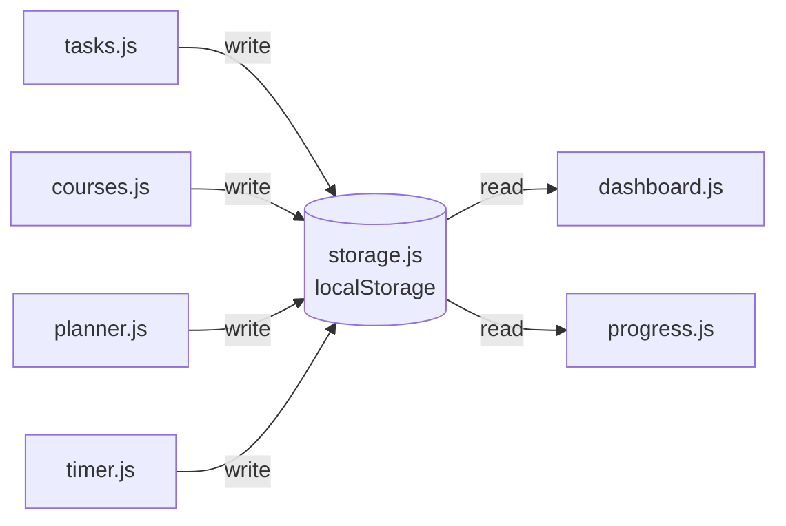
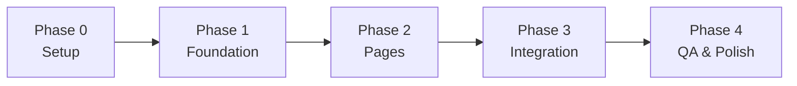

<div align="center">

# 📚 StudentHub

**A student productivity web app for tasks, courses, study sessions and focus time.**


[Features](#01-features) · [Tech Stack](#02-tech-stack) · [Structure](#03-project-structure) · [Getting Started](#04-getting-started) · [Team](#05-team--responsibilities) · [Workflow](#07-development-workflow) · [Git Rules](#08-git-workflow) · [Rules](#09-rules)

</div>

---

## 01. Features

| | Feature | What it does |
|---|---------|--------------|
| 🏠 | **Dashboard** | Overview of tasks, courses and study activity |
| ✅ | **Task Manager** | Add, view, edit, complete and delete tasks |
| 🎓 | **Course Manager** | Add courses and view course details |
| 🗓️ | **Study Planner** | Create and display planned study sessions |
| 🧭 | **Navigation & Responsive Design** | One navbar, works on desktop and mobile |
| ⏱️ | **Focus Timer** *(secondary)* | Start, pause and reset a focus session |
| 📈 | **Progress Summary** *(secondary)* | Task completion and study progress charts |

---

## 02. Tech Stack

| Category | Tools |
|----------|-------|
| **Languages** | HTML5 · CSS3 · JavaScript (ES Modules) |
| **Storage** | Browser `localStorage` (no backend) |
| **Design** | Figma |
| **Tools** | Git · GitHub · VS Code · Live Server |

---

## 03. Project Structure

```
Student-Hub/
├── index.html                 # 🏠 Dashboard
├── pages/
│   ├── tasks.html             # ✅ Task Manager
│   ├── courses.html           # 🎓 Course Manager
│   ├── planner.html           # 🗓️ Study Planner
│   ├── timer.html             # ⏱️ Focus Timer
│   └── progress.html          # 📈 Progress Summary
├── css/
│   ├── base/
│   │   ├── reset.css          # browser reset
│   │   └── variables.css      # colors, fonts, spacing
│   ├── shared/
│   │   ├── buttons.css
│   │   ├── cards.css
│   │   ├── forms.css
│   │   ├── navbar.css
│   │   └── responsive.css     # global breakpoints
│   ├── main.css               # global layout
│   └── dashboard.css · tasks.css · courses.css
│       planner.css · timer.css · progress.css    # one per page
├── js/
│   ├── shared/
│   │   ├── constants.js       # storage keys, enums
│   │   ├── storage.js         # the ONLY file that touches localStorage
│   │   ├── validators.js      # input validation
│   │   └── navbar.js          # navbar for every page
│   └── dashboard.js · tasks.js · courses.js
│       planner.js · timer.js · progress.js       # one per page
├── assets/
│   ├── images/
│   └── icons/
└── README.md
```

---

## 04. Getting Started

```bash
git clone https://github.com/mekilit21-jpg/Student-Hub.git
cd Student-Hub
```

Open the folder in **VS Code** and start it with the **Live Server** extension.

> ⚠️ Do not open the HTML files by double-clicking them. JavaScript modules do not work over `file://`.

---

## 05. Team & Responsibilities

Every file has **one owner**. Only edit the files you own. Need a change in someone else's file? Open an Issue or message the owner.

| # | Role | Member | Owns (only edit these) |
|---|------|--------|------------------------|
| 1 | **Frontend Team Leader & Integration** | | `README.md` · `css/main.css` · `css/base/reset.css` |
| 2 | **UI/UX Designer (Figma)** | | `css/base/variables.css` · `css/shared/buttons.css` · `cards.css` · `forms.css` · `assets/` |
| 3 | **Dashboard Developer** | | `index.html` · `css/dashboard.css` · `js/dashboard.js` |
| 4 | **Task Manager Developer** | | `pages/tasks.html` · `css/tasks.css` · `js/tasks.js` |
| 5 | **Course Manager Developer** | | `pages/courses.html` · `css/courses.css` · `js/courses.js` |
| 6 | **Study Planner Developer** | | `pages/planner.html` · `css/planner.css` · `js/planner.js` |
| 7 | **Focus Timer Developer** | | `pages/timer.html` · `css/timer.css` · `js/timer.js` |
| 8 | **Progress Summary Developer** | | `pages/progress.html` · `css/progress.css` · `js/progress.js` |
| 9 | **Navigation & Responsive Design** | | `js/shared/navbar.js` · `css/shared/navbar.css` · `css/shared/responsive.css` |
| 10 | **Data Management, Validation & QA** | | `js/shared/storage.js` · `constants.js` · `validators.js` |

### What each role does

| Role | Specific work |
|------|---------------|
| **Team Leader** | Creates the repo skeleton and page template, reviews and merges every PR, resolves conflicts, connects all pages at the end |
| **UI/UX Designer** | Designs all screens in Figma first, then builds the design system in CSS (colors, fonts, buttons, cards, forms) |
| **Dashboard** | Shows pending/completed task counts, upcoming deadlines, today's study sessions, course count. **Read-only.** |
| **Task Manager** | Task CRUD. Fields: title, due date, priority, status, optional course link |
| **Course Manager** | Course CRUD. Fields: name, code, instructor, schedule. Shows course details |
| **Study Planner** | Create and list study sessions (course, date, start/end time, topic). Reads courses to link a session to one |
| **Focus Timer** | Start / pause / reset. When a session ends, saves a record (duration, date) for Progress |
| **Progress Summary** | Charts and stats: task completion rate, study time per course/week. **Read-only.** |
| **Navigation & Responsive** | Navbar with correct links from both `index.html` and `pages/`, active-page highlight, mobile menu, global breakpoints, mobile testing |
| **Data & QA** | Designs data shapes, storage keys, save/load/update/delete helpers, ID generation, validation. Tests all features and reports bugs as Issues |

---

## 06. Data Ownership

Only the owner of a data type **writes** it. Everyone else **reads** it through `storage.js`.

| Data | Written by | Read by |
|------|-----------|---------|
| Tasks | Task Manager | Dashboard, Progress |
| Courses | Course Manager | Dashboard, Planner, Tasks, Progress |
| Planned study sessions | Study Planner | Dashboard, Progress |
| Focus sessions | Focus Timer | Dashboard, Progress |



---

## 07. Development Workflow



| Phase | Who | What happens |
|-------|-----|--------------|
| **0. Setup** | Team Leader | Create folders, empty files and the page template. Push to `main` (the only direct push). Everyone clones and creates a branch |
| **1. Foundation** | Designer, Data/QA, Navigation, Leader | Build the shared layer first: `variables.css` + shared styles, `constants.js` + `storage.js` + `validators.js`, `navbar.js` + `responsive.css`, `reset.css` + `main.css`. Merge before page work goes deep |
| **2. Pages** | Dashboard, Task, Course, Planner, Timer, Progress developers | Build your own page (HTML, CSS, JS) in parallel using the shared files. No shared files means no conflicts |
| **3. Integration** | Team Leader | Check navigation between pages and data flow (add a course, see it in Planner and Dashboard). Fix style inconsistencies |
| **4. QA & Polish** | Data/QA + everyone | Test every feature on desktop and mobile widths, open Issues, owners fix bugs in their own files, final check against Figma |

> During Phase 1, page developers can start HTML and page CSS, but must **not** invent their own storage keys or helpers. Wait for the shared API.

### Page template

<details>
<summary><b>Every page must follow this (click to expand)</b></summary>

<br>

Load CSS in this order, so shared styles come first and page styles can override them:

```html
<meta name="viewport" content="width=device-width, initial-scale=1.0">

<link rel="stylesheet" href="../css/base/reset.css">
<link rel="stylesheet" href="../css/base/variables.css">
<link rel="stylesheet" href="../css/shared/buttons.css">
<link rel="stylesheet" href="../css/shared/cards.css">
<link rel="stylesheet" href="../css/shared/forms.css">
<link rel="stylesheet" href="../css/shared/navbar.css">
<link rel="stylesheet" href="../css/main.css">
<link rel="stylesheet" href="../css/tasks.css">              <!-- your page CSS -->
<link rel="stylesheet" href="../css/shared/responsive.css">  <!-- always last -->

<script type="module" src="../js/tasks.js"></script>          <!-- your page JS -->
```

`index.html` uses `./css/...` instead of `../css/...`.

Your page script imports the shared files it needs:

```js
import { renderNavbar } from "./shared/navbar.js";
import { getAll, add, update, remove } from "./shared/storage.js";
import { STORAGE_KEYS } from "./shared/constants.js";
import { validateTask } from "./shared/validators.js";
```

</details>

---

## 08. Git Workflow

```bash
# 1. Start from the latest main
git checkout main
git pull origin main

# 2. Create your own branch
git checkout -b feature/your-feature

# 3. Work, then commit small and often
git add .
git commit -m "Add task form validation"

# 4. Push your branch and open a Pull Request
git push origin feature/your-feature
```

| Step | Rule |
|------|------|
| **Branch names** | `feature/tasks` · `feature/navbar` · `feature/storage` · `fix/timer-reset` |
| **Commit messages** | Clear and specific: `Add task form validation`, not `update` |
| **Pull Request** | Open a PR into `main`. The Team Leader reviews and merges |
| **Review comments** | Fix them on the same branch and push again |
| **After merge** | Run `git pull origin main` before starting new work |

---

## 09. Rules

| ✅ Do | ❌ Don't |
|-------|----------|
| Work only in the files you own | Never push directly to `main` |
| Use `storage.js` for all localStorage access | Never call `localStorage` directly in a page script |
| Use the keys from `constants.js` | Never create your own storage keys |
| Use CSS variables from `variables.css` | Never hardcode colors or fonts |
| Scope page CSS to your page (e.g. `.tasks-page`) | Never write styles that affect other pages |
| Include the viewport meta tag and the shared navbar on every page | Never edit a shared file you don't own. Open an Issue instead |
| Test with Live Server before opening a PR | Never open a PR with broken code |

---

<div align="center">

**Built by the StudentHub team** · Learn → Build → Ship

</div>
